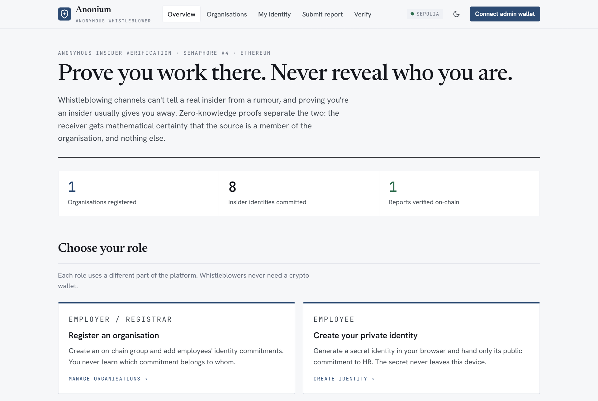
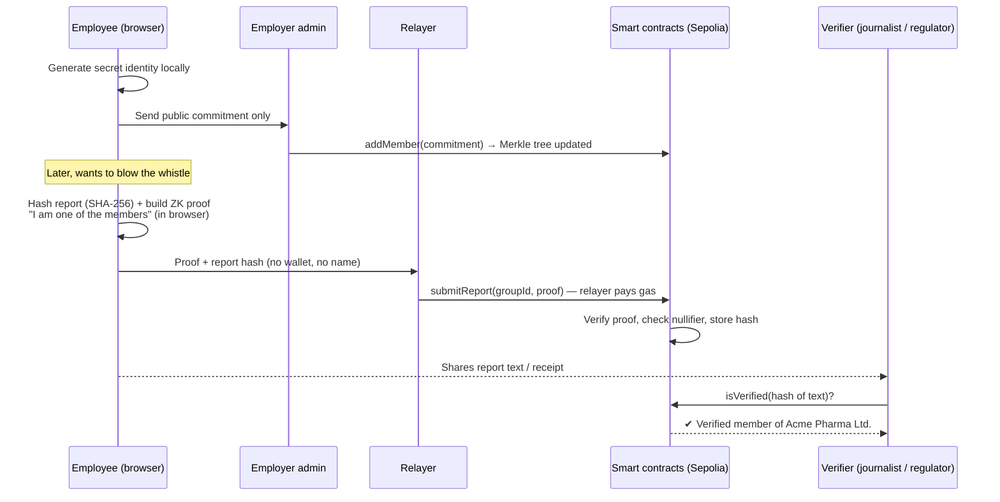
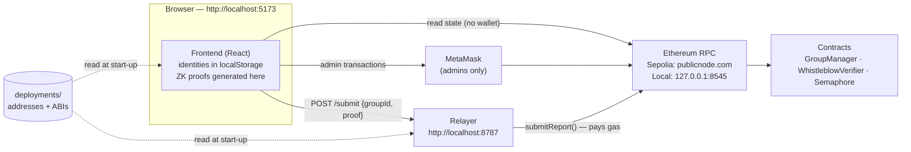
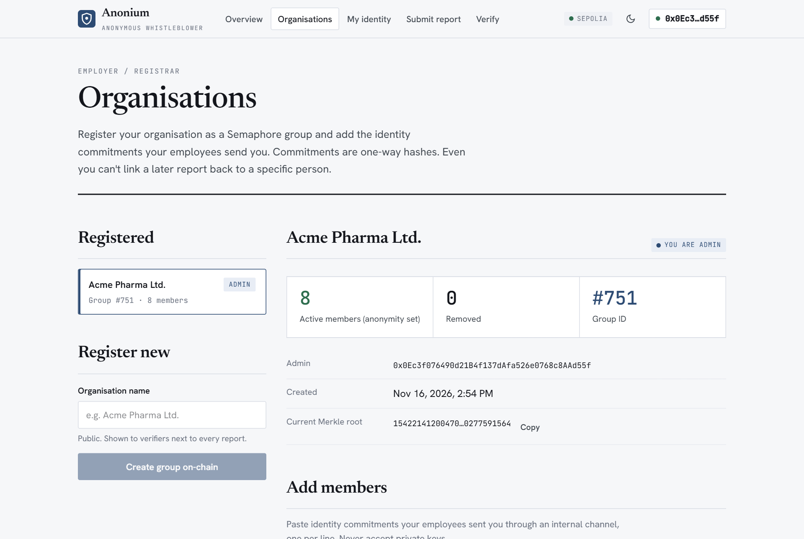
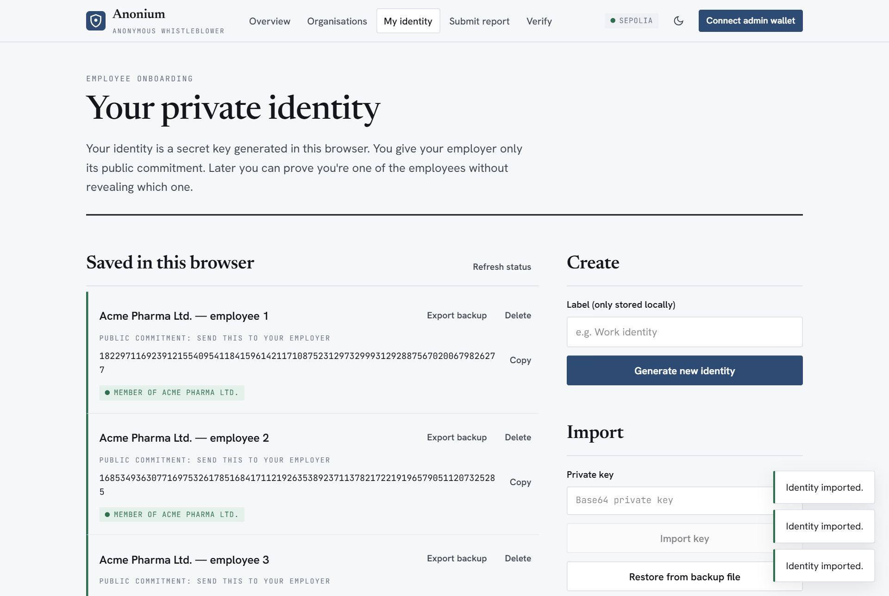
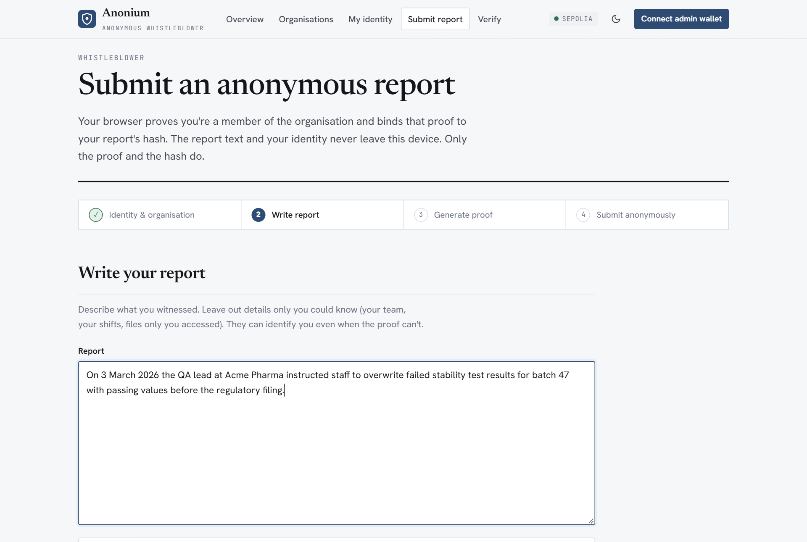
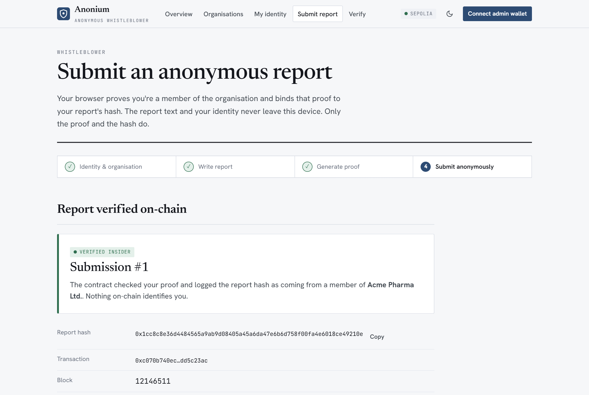
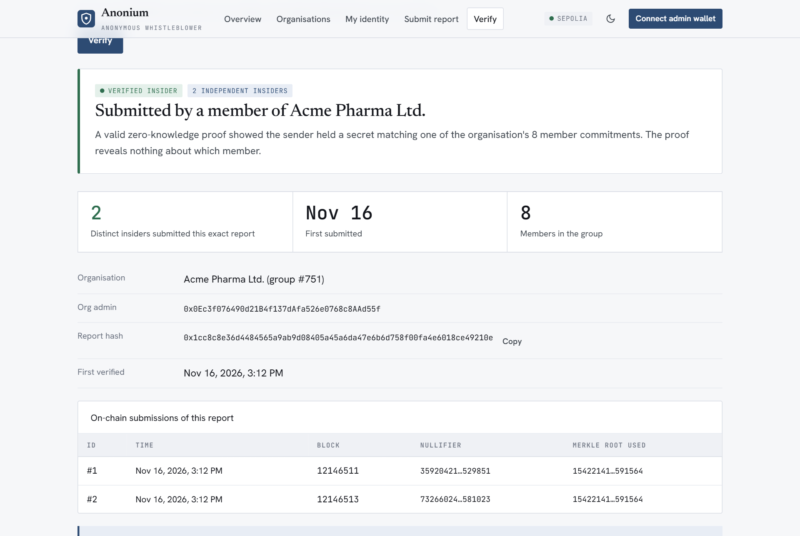

# Anonium: Anonymous Whistleblower

**Prove you are a genuine insider without revealing who you are.**

Anonium lets an employee report wrongdoing so that the receiver (a journalist, regulator or compliance team) gets mathematical proof that the report came from a real member of the organisation, and learns nothing about which member. It uses **Semaphore v4 zero-knowledge proofs** on **Ethereum (Sepolia testnet)**.



| | |
| --- | --- |
| **Live network** | Ethereum Sepolia testnet |
| **Project overview (PDF)** | [docs/Anonium-Project-Overview.pdf](docs/Anonium-Project-Overview.pdf) |
| **Demo guide with screenshots (PDF)** | [docs/Anonium-Demo-Guide.pdf](docs/Anonium-Demo-Guide.pdf) |

---

## Contents

1. [How it works](#how-it-works)
2. [Deployed contracts (Sepolia)](#deployed-contracts-sepolia)
3. [Project structure](#project-structure)
4. [How the pieces connect](#how-the-pieces-connect)
5. [Setup](#setup): [A. Local (no wallet needed)](#a-local-demo-no-wallet-no-internet-needed) · [B. Sepolia testnet](#b-sepolia-testnet-free)
6. [How to use Anonium](#how-to-use-anonium)
7. [Tests](#tests)
8. [Design decisions](#design-decisions)
9. [Security notes and limitations](#security-notes-and-limitations)
10. [Troubleshooting](#troubleshooting)

---

## How it works



1. **Organisation admin** registers the organisation on-chain (a Semaphore group) and adds employees' **identity commitments**, which are public one-way hashes.
2. **Employee** generates a **private identity** in their browser and gives the employer only the commitment.
3. **Whistleblower** writes a report. The browser hashes it and builds a **zero-knowledge proof** that says "I own one of the commitments in this group" and binds the proof to the report hash.
4. A **relayer** submits the proof, so the whistleblower's wallet address never appears on-chain.
5. The **WhistleblowVerifier** contract checks the proof and records the report hash. A per-report **nullifier** stops the same person submitting the same report twice. Different insiders submitting the same report count as **corroborations**.
6. **Anyone** (a journalist, SEBI/SEC, a compliance officer) can paste the report text on the **Verify** page and see *"Submitted by a member of Acme Pharma Ltd."*

---

## Deployed contracts (Sepolia)

| Contract | Address |
| --- | --- |
| Semaphore v4 (official PSE deployment) | [`0x8A1fd199516489B0Fb7153EB5f075cDAC83c693D`](https://sepolia.etherscan.io/address/0x8A1fd199516489B0Fb7153EB5f075cDAC83c693D) |
| GroupManager | [`0x3830e82a379c51712D7B626c409146792fA43dd3`](https://sepolia.etherscan.io/address/0x3830e82a379c51712D7B626c409146792fA43dd3) |
| WhistleblowVerifier | [`0xcE592540D951b83fB97BC1536D9e9c1C5b08e92f`](https://sepolia.etherscan.io/address/0xcE592540D951b83fB97BC1536D9e9c1C5b08e92f) |

The demo organisation is **"Acme Pharma Ltd."**, Semaphore group #751, seeded with 8 employee identities.
All addresses and ABIs are in [`deployments/`](deployments/).

---

## Project structure

```
Anonium/
├── contracts/            Solidity + Hardhat
│   ├── contracts/
│   │   ├── GroupManager.sol         organisations + member commitments (Semaphore groups)
│   │   └── WhistleblowVerifier.sol  verifies proofs, stores report hashes, nullifiers, corroborations
│   ├── scripts/deploy.js            deploys contracts, writes deployments/
│   ├── scripts/seed-demo.js         creates "Acme Pharma Ltd." with 8 demo identities
│   ├── test/Whistleblow.test.js     17 tests with real ZK proofs
│   └── .env                         YOUR Sepolia private key (git-ignored, create it yourself)
├── relayer/              Node.js + Express: submits proofs and pays gas
├── frontend/             React 19 + Vite + Tailwind 4 web app
│   └── src/pages/        Home, Admin (Organisations), Identity, Report, Verify
├── deployments/          contract addresses + ABIs shared by relayer and frontend
├── docs/                 project overview PDF, demo guide PDF, screenshots
├── start-local.ps1       one command: local blockchain demo
└── start-sepolia.ps1     one command: Sepolia testnet demo
```

---

## How the pieces connect



| Connection | Address | Configured in |
| --- | --- | --- |
| Frontend (web app) | `http://localhost:5173` | `frontend/package.json` (Vite) |
| Relayer API | `http://localhost:8787` (`GET /health`, `POST /submit`) | `relayer/.env` → `PORT` |
| Frontend → relayer | `VITE_RELAYER_URL` | `frontend/.env.sepolia` (Sepolia) / default (local) |
| Frontend → blockchain (read-only) | `VITE_RPC_URL`, default public Sepolia RPC | `frontend/src/lib/config.js` |
| Relayer + deploy scripts → blockchain | `SEPOLIA_RPC_URL`, default `https://ethereum-sepolia-rpc.publicnode.com` | `contracts/.env` |
| Wallet key (deployer, org admin and relayer) | `DEPLOYER_PRIVATE_KEY` | `contracts/.env` (**never commit**) |
| Which chain the app uses | `VITE_CHAIN_ID` (`31337` local, `11155111` Sepolia) | `frontend/.env.sepolia` |
| Contract addresses + ABIs | `deployments/deployments.json`, `deployments/abi/` | written by `scripts/deploy.js` |
| ZK proving keys | downloaded once from `snark-artifacts.pse.dev` | automatic (Semaphore) |

**Who needs a wallet?** Only organisation admins, who use MetaMask to add or remove members. Whistleblowers and verifiers **never** connect a wallet.

---

## Setup

### Prerequisites

| Tool | Version | Get it |
| --- | --- | --- |
| Node.js | 20 or newer (22 recommended) | https://nodejs.org |
| Git | any | https://git-scm.com |
| Google Chrome + MetaMask | only for Sepolia admin actions | https://metamask.io |

```powershell
git clone https://github.com/FireFlamingo/Anonium.git
cd Anonium
```

Both start scripts install all dependencies automatically on the first run. To do it by hand: `npm install` inside `contracts`, `relayer` and `frontend`.

### A. Local demo (no wallet, no internet needed)

Everything runs on your machine on a private Hardhat blockchain. It's free and instant, which makes it good for development.

```powershell
powershell -ExecutionPolicy Bypass -File .\start-local.ps1
```

The script:
1. starts a local blockchain (`http://127.0.0.1:8545`)
2. deploys Semaphore and both contracts
3. creates "Acme Pharma Ltd." with 8 demo employees
4. starts the relayer (`:8787`) and the web app (`:5173`)
5. opens the browser

On the local chain you can connect as **"Hardhat account #0 (demo org admin)"** from the wallet menu without MetaMask.

> The local chain is wiped each time it stops. Running the script again redeploys everything.

### B. Sepolia testnet (free)

Sepolia ETH is **test money with no real value**, available free from faucets.

**1. Create a testnet wallet in MetaMask**
- Install MetaMask, create a wallet, and save the recovery phrase.
- Open the network menu, turn on **Show test networks**, and select **Sepolia**.
- **Add account** and name it e.g. "Anonium". Use a testnet-only account, never one with real funds.

**2. Get free Sepolia ETH (about 0.05 is plenty)**
- https://sepolia-faucet.pk910.de: paste your address, mine in the browser for 10–30 minutes, then claim. You don't need an account.
- or the Google Cloud Web3 Sepolia faucet.

**3. Put your private key in `contracts/.env`**
- MetaMask → account menu (⋮) → **Account details** → **Show private key**. Enter your password and copy the 64-character key. It is *not* the `0x…` address.
- Create `contracts/.env` (copy `contracts/.env.example`) and fill in:
  ```ini
  DEPLOYER_PRIVATE_KEY=your64characterkey
  SEPOLIA_RPC_URL=https://ethereum-sepolia-rpc.publicnode.com
  ```
- This is the **only** file you edit. The relayer reuses the same key and RPC.

**4. Run**
```powershell
powershell -ExecutionPolicy Bypass -File .\start-sepolia.ps1
```
- If `deployments/deployments.json` has no Sepolia entry, the script deploys your own copy of the contracts and seeds "Acme Pharma Ltd.". This takes about 2 minutes.
- If it does, it reuses that deployment.
- It then starts the relayer and the web app in Sepolia mode and opens http://localhost:5173.
- Keep the two new windows (**Relayer (Sepolia)** and **Frontend (Sepolia)**) open while using the app.

> **Fresh clone?** `deployments.json` already points at the contracts above. You can use them as-is and register your own organisation on the Organisations page. To deploy your own copy, remove the `"11155111"` block from `deployments/deployments.json` and run the script again.

**Manual equivalent** (4 terminals):
```powershell
cd contracts; npm run deploy:sepolia; npm run seed:sepolia   # once
cd relayer;   npm run start:sepolia
cd frontend;  npm run dev:sepolia
```

---

## How to use Anonium

The app has five pages in the top navigation.

### Overview
Explains the problem, the four roles, and what is revealed vs. hidden. It shows live counts of organisations, members and verified reports.

### 1. Organisations (employer admin)

1. Click **Connect admin wallet → MetaMask** and approve. Make sure MetaMask is on **Sepolia**.
2. **Register an organisation**: type a name and click **Create group on-chain**. You become its admin.
3. **Add members**: paste one or more identity commitments that employees sent you (one per line) and click **Add N members**.
4. **Remove a member**: click **Remove** in the member tree. The leaf becomes `0` and the Merkle root changes.

### 2. My identity (employee)

1. Click **Generate new identity**. The secret key is created and stored **only in this browser**.
2. Click **Copy** next to the *public commitment* and send it to your employer admin.
3. Click **Export backup** to save the key file safely. There is no recovery if you lose it.
4. Once the admin adds you, a green **MEMBER OF …** chip appears.

*For demos: the **Demo identities** list lets you import the 8 seeded Acme Pharma employees with one click.*

### 3. Submit report (whistleblower)

1. **Identity & organisation**: pick your identity and the organisation.
2. **Write report**: type the report. Its SHA-256 hash is shown live.
3. **Generate proof**: the zero-knowledge proof is built in your browser in about 1–5 seconds.
4. **Submit anonymously**: the relayer posts it to Sepolia. You get a **submission number**, an **Etherscan link** and a **downloadable receipt**.
5. Share the report text (or receipt) with a journalist or regulator through any channel.



### 4. Verify (journalist / regulator / compliance)

1. Choose a lookup method: **Report text**, **Submission ID**, **Report hash** or **Receipt file**.
2. Click **Verify**.
   - ✅ **Verified insider**: shows the organisation, its admin, the time, and how many **independent insiders** submitted the same report.
   - ❌ **Not verified**: the text was changed (even one character) or never submitted.
3. **Recent verified submissions** lists everything recorded on-chain.

---

## Tests

```powershell
cd contracts
npm test      # 17 tests, all with real Groth16 proofs
```

The tests cover:
- group creation and admin-only access
- duplicate and zero commitments
- the off-chain Merkle root matching the on-chain root (also after removal)
- valid proofs submitted through a third-party relayer
- proofs from outsiders, tampered signals and scope mismatches
- double submission (nullifier)
- corroboration by multiple insiders
- the revocation window after a member is removed
- pagination

---

## Design decisions

| Original spec | Implementation | Why |
| --- | --- | --- |
| `createGroup(uint256 depth)` | `createGroup(string name)` | Semaphore v4 uses a dynamic-depth LeanIMT, so no depth is needed. The name is shown to verifiers. |
| `submitReport(groupId, signal, nullifierHash, uint256[8] proof)` | `submitReport(groupId, SemaphoreProof)` | The v4 proof struct carries the Merkle root and depth needed for verification. |
| Whistleblower sends the transaction | A **relayer** sends it | A personal wallet would permanently link the person to the report. The relayer can't alter it, because the proof binds the report hash. |
| Block reuse of a signal | `scope = report hash`, nullifiers per group | The same person can't resubmit a report, while different insiders can **corroborate** it. |
| Own Semaphore deployment | Official Semaphore v4 on Sepolia | It's audited, saves gas, and the local chain still deploys its own copy. |

**On-chain:** identity commitments, Merkle roots, report hashes, nullifiers, timestamps.
**Never leaves the browser:** report text (unless you share it), identity secrets, which member you are.

---

## Security notes and limitations

- **Never commit `contracts/.env`.** It holds a private key and is git-ignored. `deployments/demo-identities.json` (demo private identities) is git-ignored too.
- **Admin trust:** the admin decides who is a member and could add fake identities. Verifiers see the admin address next to every verdict.
- **Revocation window:** a removed member can still prove against the previous root for 1 hour.
- **Small groups give weak anonymity:** with 3 members, each is a 1-in-3 suspect. The UI warns below 3.
- **No identity recovery:** if you lose the key, you need to be re-added with a new identity.
- **The relayer can censor** (refuse to forward a report) but cannot forge or change one.
- A verified report proves *membership*, not that the report is *true*.

---

## Troubleshooting

| Problem | Fix |
| --- | --- |
| `start-sepolia.ps1` says to paste your key | Fill `DEPLOYER_PRIVATE_KEY` in `contracts/.env` (64 hex characters, not the `0x…` address). |
| "has 0 ETH" | Faucet ETH hasn't arrived yet. Wait a minute and retry. |
| "replacement transaction underpriced" | The public RPC lagged. Run the script again (the deploy scripts track nonces to avoid this). |
| Red "No contracts deployed for chain …" warning | Contracts aren't deployed for the selected chain. Run the matching start script. |
| Submit fails with "Couldn't reach the relayer" | The **Relayer** window was closed. Run the start script again. |
| "File cannot be loaded… not digitally signed" | Use the full command with `-ExecutionPolicy Bypass`. |
| `localhost:5173` doesn't open | Run the command from inside the project folder (the one containing `start-sepolia.ps1`). |

---

## Tech stack

Solidity 0.8.28 · Hardhat 2 · Semaphore v4 (Groth16, Poseidon, LeanIMT) · Ethers 6 · Node.js / Express 5 · React 19 · React Router 7 · Vite 8 · Tailwind CSS 4

*Built as a Semester 5 Blockchain Technology course project.*
